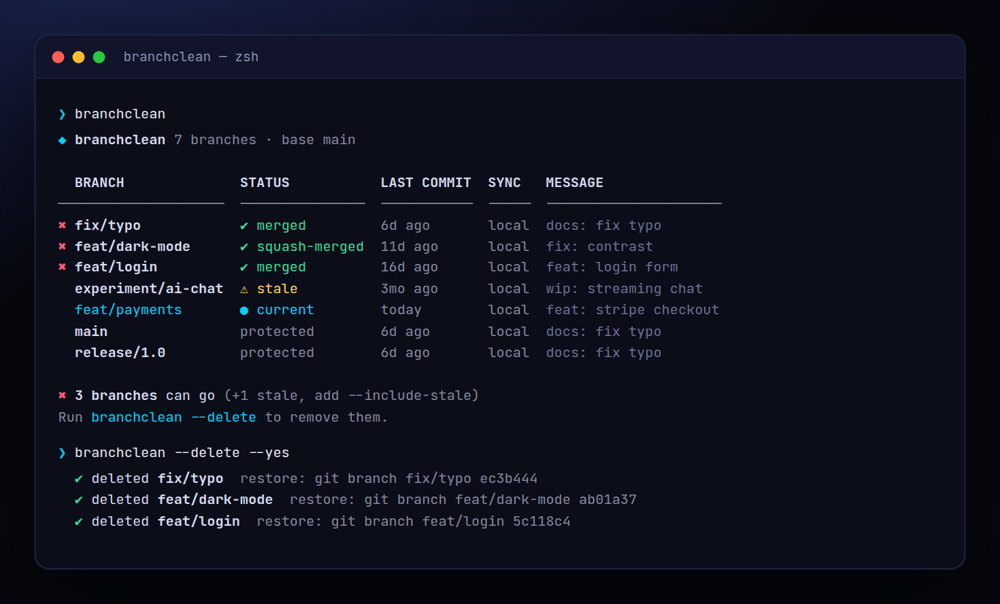

<!-- ═════════════ HEADER ═════════════ -->
<p align="center">
  
</p>

<p align="center">
  
</p>

<p align="center">
  <a href="https://github.com/krishyaa06/prism-branch-cleaner/actions/workflows/ci.yml"></a>
  
  
  <a href="LICENSE"></a>
</p>

<p align="center">
  
</p>


## ⚡ Overview

**Prism Branch Cleaner** (`branchclean`) shows every local branch with its status and deletes the ones that are done. Unlike `git branch --merged`, it also detects **squash-merged** branches (the default on GitHub PRs), so `feat/dark-mode` merged as `feat: dark mode (#12)` is recognised as safe to delete. Stale and remote-deleted branches are flagged but only removed when you ask. It never touches the current branch, your base branch, or protected names, and prints a restore command for every deletion.

## ✨ Features

- Detects **merged** and **squash-merged** branches (patch-id comparison, no network)
- Flags **stale** (idle N days) and **remote deleted** (`--fetch` prunes first) branches
- Protected: current branch, base, `main`/`master`/`develop`/`staging`/`production`/`release/*` + `--protect`
- Asks before deleting; `--yes` for scripts. Prints `git branch <name> <sha>` to **restore** each one
- `--remote` also deletes on origin; `--include-stale` for a deep clean
- Ahead / behind / local-only sync info, `--json`, auto-detects `main` vs `master`. Zero deps

## 🚀 Quick Start

```bash
# run without installing
npx github:krishyaa06/prism-branch-cleaner 

# or install globally
npm install -g github:krishyaa06/prism-branch-cleaner
branchclean --delete
```

Requires Node.js 18.17+. No dependencies.

## 🛠️ Usage

```text
branchclean                 show branches + what's safe to delete
branchclean --delete        delete merged / squash-merged branches (asks first)
branchclean --delete --yes  …without asking

  -b, --base <branch>      compare against (default: origin/HEAD, main or master)
      --stale <days>       mark branches idle for N days (default 30)
      --include-stale      also delete stale and remote-deleted branches
      --remote             also delete the branch on origin
      --fetch              git fetch --prune first
      --protect <list>     never touch these, e.g. "demo,exp/*"
  -y, --yes                don't ask
      --json               machine-readable output
```

### Git alias

```bash
git config --global alias.tidy '!npx --yes github:krishyaa06/prism-branch-cleaner --fetch --delete'
git tidy
```

Try it on a throwaway repo: `sh examples/make-demo-repo.sh /tmp/demo && branchclean /tmp/demo`.

## 📁 Project Structure

```
prism-branch-cleaner/
├── assets/
│   ├── logo.png
│   └── logo.svg
├── bin/
│   └── branchclean.js   # CLI entry
├── examples/
│   └── make-demo-repo.sh   # throwaway repo with every branch type
├── src/
│   ├── index.js   # branch analysis, squash detection, delete
│   └── ui.js   # colours, tables
├── test/
│   └── branchclean.test.js
├── .gitignore
├── LICENSE
└── package.json
```

## 🧪 Tests

```bash
npm test
```

Tests use the built-in `node:test` runner, so there is nothing to install. CI runs them on Node 20 and 22.

## 🤝 Contributing

1. Fork the repo and create a branch: `git checkout -b feature/my-idea`
2. Make your change and add a test in `test/`
3. Run `npm test` and open a Pull Request

## 🔷 Part of Prism Protocol

Prism Branch Cleaner is one of the open-source tools built by [Prism Protocol](https://dc.gg/prismprotocol), a tech community where young builders learn, ship and compete together.

## 👤 Author

<table>
  <tr>
    <td align="center">
      <a href="https://github.com/krishyaa06"><br><b>Soumya Bhandare</b></a><br>
      <sub>Founder @ Prism Protocol</sub>
    </td>
    <td>
      <a href="https://dc.gg/prismprotocol"></a><br>
      <a href="https://instagram.com/prism_protocol_"></a><br>
      <a href="https://x.com/krishyaa06"></a>
    </td>
  </tr>
</table>

## 📄 License

Released under the [MIT License](LICENSE).

<p align="center">
  <b>If you like this project, consider giving it a ⭐</b><br>
  <sub>"Build. Create. Compete." · Made with ⚡ by Prism Protocol</sub>
</p>


